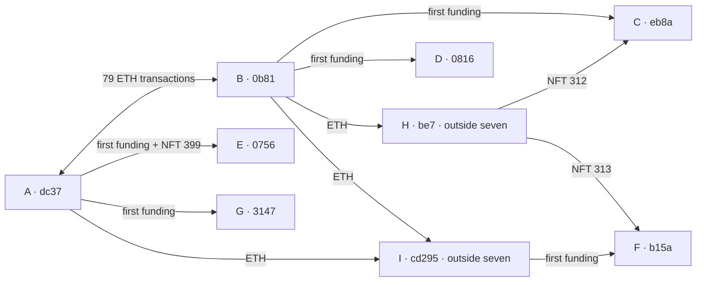

# Seven-wallet investigation — Propaganda round

**Assessment:** These seven form a financially connected group. Coordination or some shared control is plausible. **Their human owner is unknown. Self-voting for the first-place submitter has not been verified.**

Final production snapshot: **23 October 2026, 21:12 UTC**. All dates below are UTC.

## What stands out

- **194 direct ETH transactions + 1 internal ETH transfer** connect 14 pairs within the seven. A and B are the main hubs; they exchanged ETH in 79 direct transactions.
- A supplied E with **NFT 399**. Outside wallet H supplied C and F with **NFTs 312 and 313**.
- C paid H **0.033 ETH**, matching NFT 312’s auction price, **44 minutes before receiving it**. This is consistent with a purchase or reimbursement at cost.
- Outside wallet I received ETH from A/B, then supplied F’s first observed Base funding.
- All seven cast their first recorded Yellow Rounds ballots over **about 34 minutes**: **15 votes each / 105 total** for **Support Yellow Artists**. Their 360 total votes also supported six other entries.
- **NFT acquisitions date to 2024–2025.** These are older Base wallets entering Rounds voting for the first time in the saved history.

## The seven wallets

Every wallet below has **Owner unknown**. Auction prices exclude gas. A/B are investigation anchors, not verified owners of the other addresses.

| ID / BaseScan | Yellow profile | NFT acquisition history | NFTs at voting snapshot | Votes to first place |
|---|---|---|---:|---:|
| [A · 0xdc37…11f1](https://basescan.org/address/0xdc37e6f67bfb7361e25731fc477903e172d211f1) | [Profile](https://www.yellowcollective.art/profile/0xdc37e6f67bfb7361e25731fc477903e172d211f1) | #308 — 2024-09-13 · 0.0242 ETH #328 — 2024-09-29 · 0.0363 ETH #399 — 2024-11-26 · 0.01 ETH Sent #399 to E on 2025-01-02 | 2 | 15 |
| [B · 0x0b81…19f7](https://basescan.org/address/0x0b81bffce9970aca9868120eee1bcc8de19119f7) | [Profile](https://www.yellowcollective.art/profile/0x0b81bffce9970aca9868120eee1bcc8de19119f7) | #292 — 2024-08-30 · 0.0377 ETH #309 — 2024-09-14 · 0.02662 ETH #549 — 2025-03-27 · 0.00517 ETH | 3 | 15 |
| [C · 0xeb8a…2c00](https://basescan.org/address/0xeb8a03b68e4f5ee0f02ff612915bfafba4902c00) | [Profile](https://www.yellowcollective.art/profile/0xeb8a03b68e4f5ee0f02ff612915bfafba4902c00) | #312 — 2024-09-15 · from H | 1 | 15 |
| [D · 0x0816…240c](https://basescan.org/address/0x08165c34b6689a7b35ec1a57d1265f83e758240c) | [Profile](https://www.yellowcollective.art/profile/0x08165c34b6689a7b35ec1a57d1265f83e758240c) | #403 — 2024-11-28 · 0.0121 ETH | 1 | 15 |
| [E · 0x0756…9740](https://basescan.org/address/0x07566caf069465977e9b0d3a96629c73a6c69740) | [Profile](https://www.yellowcollective.art/profile/0x07566caf069465977e9b0d3a96629c73a6c69740) | #399 — 2025-01-02 · from A | 1 | 15 |
| [F · 0xb15a…ef3d](https://basescan.org/address/0xb15acc09c28226c7b47918f14951a65a0671ef3d) | [Profile](https://www.yellowcollective.art/profile/0xb15acc09c28226c7b47918f14951a65a0671ef3d) | #313 — 2025-01-27 · from H | 1 | 15 |
| [G · 0x3147…792b](https://basescan.org/address/0x31475a5652efbb267b3afdd9591ef05406db792b) | [Profile](https://www.yellowcollective.art/profile/0x31475a5652efbb267b3afdd9591ef05406db792b) | #407 — 2024-12-02 · 0.01618 ETH | 1 | 15 |

## The useful paths

Outside intermediaries: [H · 0xbe7b…fa3d](https://basescan.org/address/0xbe7bfad8952ae92abb8779aa4d6826839e82fa3d) (NFT supplier) and [I · 0xcd29…30c1](https://basescan.org/address/0xcd295a33541d5aeb259c05ad51ef12b5e7fa30c1) (funding intermediary). Their owners are unknown.

Arrows show transactions/asset history. They do not establish who controls an address. The appendix links each step.

## Connection to first place

**Support Yellow Artists** received 105 votes from the seven and finished first with 318 votes. Submitter: [0xcb6e…7527](https://basescan.org/address/0xcb6eb98d0533dd42367cd064fc5b988814187527).

No direct ETH/NFT/delegation link to the submitter was found in the collected evidence. A bounded search through four steps found no path after excluding identified infrastructure. The shared two-step ETH counterparty was **RelayReceiver**, a service contract.

The apparent common Ethereum depositor was also a service: **LI.FI AcrossFacetPacked**. The original transactions show A/B each bridged from their own same-address Ethereum wallet.

**Recommendation:** Review possible coordination. This evidence alone does not justify attributing these wallets to the first-place submitter or calling their 105 votes proven self-votes.

## Evidence and limits

[Detailed evidence and transaction links](evidence-appendix.md) · [NFT timeline CSV](nft-timeline.csv) · [ETH ledger CSV](native-transfer-ledger.csv) · [Ballots CSV](wallet-votes.csv)

NFT histories use the prior full contract-event scan through Base block **53,000,299** plus fresh receipt/auction checks. Normal histories reached their final provider page. Internal histories for A/B/C/H were capped at 4,000 records each. Other tokens/chains, private arrangements and all possible intermediary wallets are not covered.

**Read-only:** No votes, winners, accounts or production data changed.
